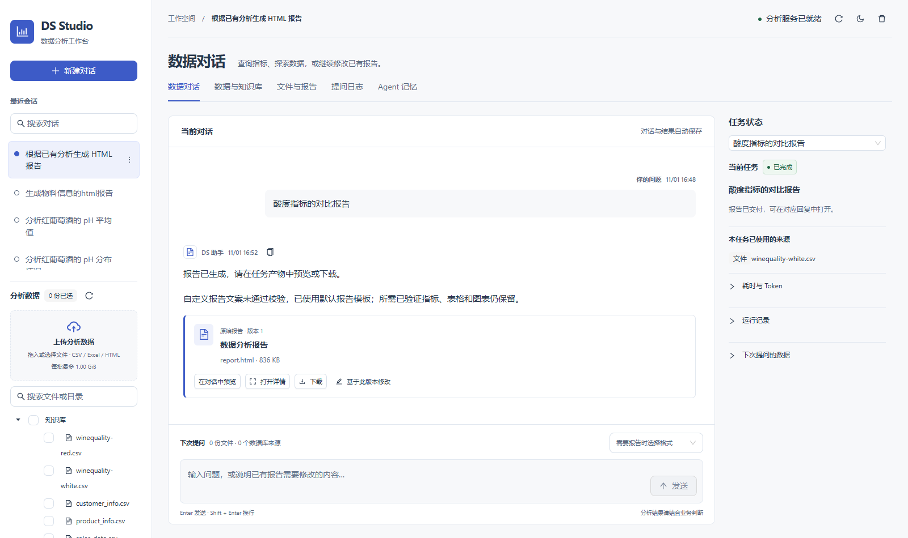
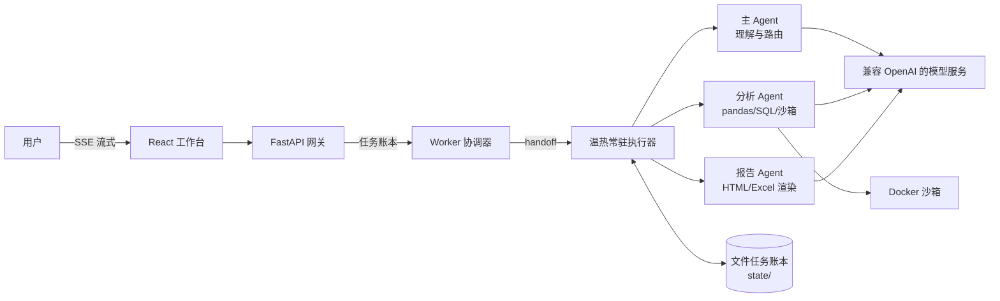

# DS Studio

[](https://github.com/19238daig/DS-Studio/actions/workflows/ci.yml)


基于 **React 19 + FastAPI + DeepAgents** 的多 Agent 数据分析工作台：通过对话分析 CSV / Excel / 静态 HTML 或已授权的 PostgreSQL 数据，在受限 Docker 沙箱中执行生成的 Python，产出带交互 SVG 图表的 HTML / Excel 报告，并支持在后续对话中增量修订。

**防幻觉设计**：界面上展示的每一个数字都强制来自应用校验的已验证指标——模型只能通过 `{{metric:analysis_id:metric_key}}` 占位符引用结果，任何未绑定的数值声明都会被应用拒绝。



## 亮点

| 维度 | 实现 | 量化结果 |
|---|---|---|
| 多 Agent 管线 | 理解 → 分析 → 报告三角色，隔离上下文、预算治理、fast-path 路由 | 简单问答单次模型调用直达 |
| 防幻觉指标绑定门 | 占位符绑定 + 数字守卫正则 + 标识放行，拒绝即自动兜底 | 展示数值 100% 来自已验证结果 |
| 温热常驻执行器 | 常驻子进程 + handoff 交接，消除每任务导入冷启动 | 简单问答 **12s → 5.3s（-56%）** |
| 质量护栏 | 输出截断检测、失败预算的部分交付、无进展熔断、递增退避重试 | 中等分析 **183s → 43s** |
| 全链路可观测 | 任务步骤条、分段流式回答、工具活动镜像、token 用量 | 等待过程全程可见 |
| 工程纪律 | 651 pytest + vitest + Playwright e2e，CI 门禁 | 三轮缺陷审查修复 16+ 生产缺陷 |

## 架构



- **主 Agent**：理解需求、路由委派；单指标问题走 query_metric 快速路径直达。
- **分析 Agent**：analyze_dataset / run_python（受限 Docker）/ run_sql，产出带口径定义的已验证指标。
- **报告 Agent**：create_report / 精准修订，所有数字经指标占位符绑定后渲染。
- **防幻觉门**：回答与报告中的每个数值都必须绑定已验证指标，未绑定声明被拒绝并触发自动兜底。

架构与边界详见 [架构说明](docs/ARCHITECTURE.md)。

## 快速开始（Windows PowerShell）

```powershell
git clone https://github.com/19238daig/DS-Studio.git
cd DS-Studio
python -m venv .venv
.\.venv\Scripts\python.exe -m pip install -r requirements.lock
Copy-Item .env.example .env
```

编辑本机 `.env`，填写 `API_KEY`、`BASE_URL` 与模型名称。**不要将 `.env` 提交到 GitHub。** 数据库默认关闭；文件分析不要求数据库连接。

启动 Docker，构建沙箱镜像并构建前端：

```powershell
docker build --pull=false -t ds-analysis:local -f docker/Dockerfile docker
cd frontend; npm ci; npm run build; cd ..
```

启动工作台：

```powershell
powershell -ExecutionPolicy Bypass -File scripts/start.ps1
```

- 工作台界面：<http://127.0.0.1:8000/>（与 API 同源）
- FastAPI 文档：<http://127.0.0.1:8000/docs>

停止服务：`powershell -ExecutionPolicy Bypass -File scripts/stop.ps1`。macOS / Linux 使用 `.venv/bin/python` 分别运行 `uvicorn src.api:app` 与 `worker.py`；前端热更新开发用 `scripts/dev.ps1`（Vite 代理 `/api` 到 FastAPI）。

## 使用

1. 侧栏新建对话，上传文件（或把公开材料放到本机 `KB/`），选择本轮数据来源后提问，例如"计算销售额平均值，只返回结论"。
2. 等待期间界面显示管线步骤条（理解需求 → 数据分析 → 生成报告）、工具活动与逐秒计时，回答分段流式渲染。
3. 需要报告时选择 HTML / Excel 格式并说明主题；完成后在对应回复下预览和下载。
4. 继续说明修改目标（"删除建议章节""Top 15 改 Top 10"），原版保留、另存修订版。
5. 每位专家在"Agent 记忆"页积累经过验证的任务经验，后续同类问题自动注入。

## 可选 PostgreSQL

在 `.env` 中配置 `DB_ENABLED` 与独立管理/只读身份，然后用 `scripts/db_manage.py` 初始化与导入（数据集不随仓库提供）。Agent 不接收数据库管理密码，也不执行写入 SQL。详见 [数据库说明](db/README.md)。

## 目录与私有文件

| 路径 | 用途 | 提交到 GitHub |
| --- | --- | --- |
| `frontend/`、`src/`、`templates/` | React 界面、API、Agent、数据与报告实现 | 是 |
| `config/`、`skills/`、`vendor/` | 提示词、项目适配和带许可证的技能参考 | 是 |
| `db/migrations/`、`docker/`、`scripts/`、`tests/` | 迁移、沙箱、工具和自动化测试 | 是 |
| `.env.example` | 无凭据的配置模板 | 是 |
| `.env`、`KB/`、`input/`、`datasets/`、`data/` | 本机密钥和数据集 | **否** |
| `state/`、`memory/`、`report/`、`script_output/`、`.runtime/` | 会话、记忆、报告和中间产物 | **否** |

`skills/design/ui-ux-pro-max` 里的 CSV 是上游公开的设计参考目录，不是用户分析数据。

## 开发与安全

```powershell
.\.venv\Scripts\python.exe -m pytest -q
cd frontend && npm test && npm run typecheck && npm run build
```

测试使用临时工作区和合成数据；部分测试需要本机 PostgreSQL 或 Docker。E2E 使用隔离 API / Worker，不调用付费模型。CI 在 GitHub Actions 运行核心回归与前端构建。详情见 [开发说明](docs/DEVELOPMENT.md)。

当前产品面向单用户本地运行，没有面向公网的完整多租户认证体系。不要直接暴露服务端口；请阅读 [安全说明](SECURITY.md)。模型生成的定性解释仍需人工判断，指标绑定与来源检查不等于证明所有结论正确。

## 许可证

项目原创代码采用 [MIT](LICENSE)。第三方技能保留其 Apache-2.0 / MIT 等原许可证，详见 [THIRD_PARTY_NOTICES.md](THIRD_PARTY_NOTICES.md)。
