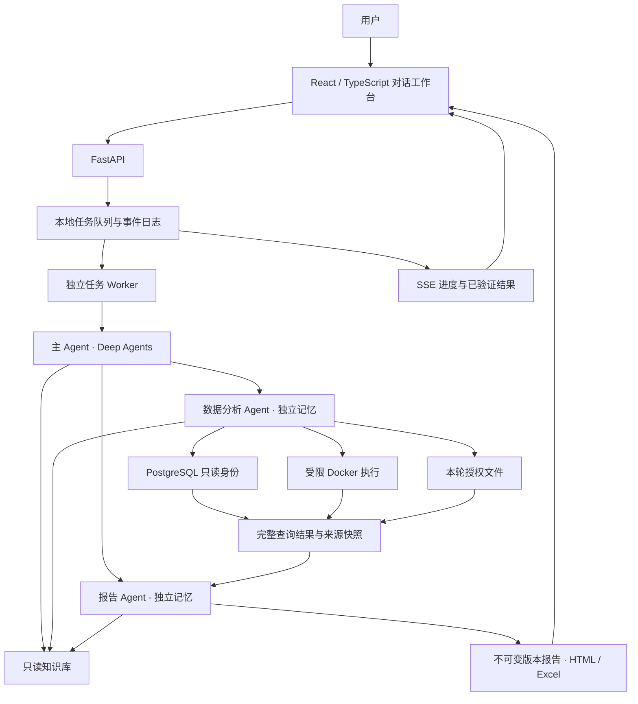

# 架构说明

主 Agent 选择工具和委派范围；固定指标可走直接计算路径，复杂问题进入专家流程。角色使用隔离的上下文与专家记忆。技能是经过项目适配的方法指导，不授予额外的数据或执行权限。

SQL 通过受控只读查询入口执行，完整结果、SQL、元数据及哈希登记为分析证据；数据库没有启用时仍可分析上传文件。Python 只在禁网、非 root、资源受限的容器内执行，输入只读挂载，宿主机凭据不进入容器。

报告层负责核验分析来源、指标引用和安全 SVG。修订以指定版本、哈希与修改目标为基础，未修改内容继承，输出新文件，不覆盖原件。报告附件按任务绑定到相应助手回复。

事件与 Token 用量按任务记录。流式进度改善等待体验；模型思考内容不作为公共流协议。上下文优化保留完整用户需求、来源选择、分析 ID、报告版本和修改目标，不以缩小问题代替性能优化。

React 前端由 FastAPI 同源提供，开发时由 Vite 代理 API。TanStack Query 管理服务器状态，Zustand 仅管理按会话隔离的草稿、选择和主题，不持久化密钥或完整历史。SSE 按任务订阅并按序列去重，失败时继续轮询已有任务；只有明确发送操作创建任务。报告在有内容安全策略的沙箱 iframe 中预览，下载与修订继续由后端验证。
